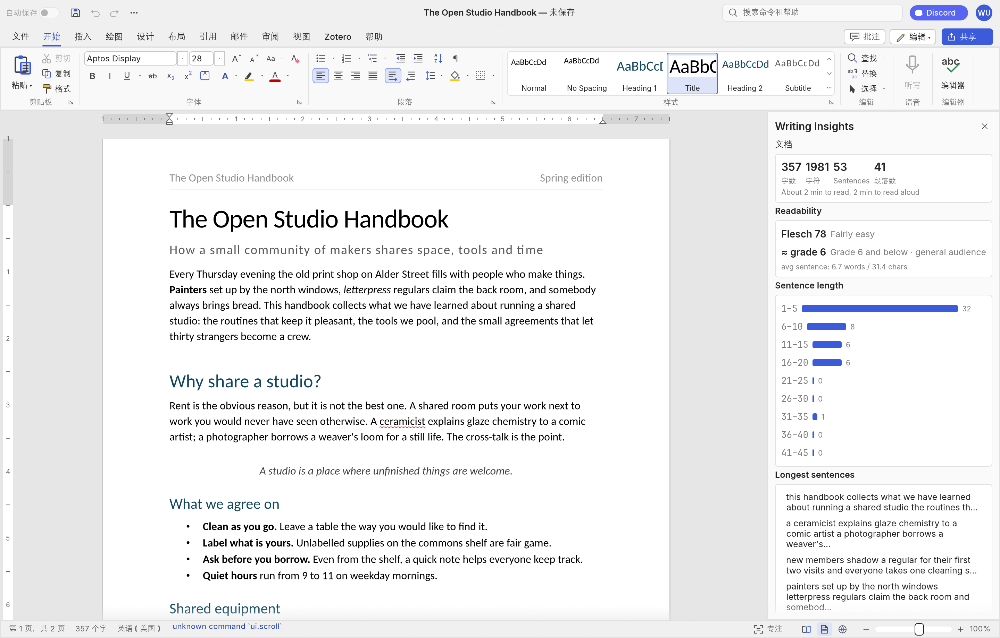

# 四、软件维护 —— 新功能「Writing Insights（写作洞察）」

## 4.1 需求与创意

**需求**：写作者（学生、报告撰写者）在编辑时希望就地获得「这段文字好不好读、哪里可以改」
的反馈。专业工具（如 Word 编辑器/Grammarly）依赖云服务或语言模型；WordCraft 的哲学是
本地、离线、确定性。

**创意**：新增一个纯本地统计的 **Writing Insights** 子系统——六个经典可读性公式 + 六类
写作问题检测，以 Review 选项卡侧面板、CLI 子命令、`review.insights` 命令三种形态提供，
**无网络、无模型调用、同输入恒同输出**。中英文混排均有计量方案。

规模：新增 `wordcraft-insights` crate 与集成代码约 **2,600 行**（含 21 项单元测试）。

## 4.2 设计方案

### 架构位置

遵循分层规则放在 **L2**（读 `doc` 文档模型，不依赖 engine/ui），并在 `xtask/src/layers.rs`
的分层表中登记——与上游的架构约束工具保持一致。

```
doc ──► insights(L2) ──► engine: review.insights 命令 ──► ui-egui 面板 / CLI / MCP
```

### 数据与算法

- **统计**（stats.rs）：UAX 风格分词（拉丁词 + 逐 CJK 字）、缩写感知分句（含 CJK 句末符）、
  元音组法音节计数（数字串计 1）。
- **指标**（metrics.rs）：Flesch、Flesch-Kincaid、Gunning Fog、SMOG、Coleman-Liau、ARI；
  拉丁词不足 10 个或占比 <25% 时不给等级（避免对中文文本输出无意义的年级）。
- **检测**（detectors.rs）：长句（>45 词或 CJK >70 字）、被动语态（be + 不规则/规则分词，
  3 词窗口）、36 条冗余短语表、21 条填充副词表、连续重复词、句首重复；每条 finding 带
  字节区间。
- **报告**（report.rs）：serde JSON 模型 + 纯文本/Markdown 渲染器 + 9 桶句长直方图 +
  top-20 内容词 + 预渲染的 Flesch/年级 headline（UI 只读 JSON，不反向依赖 insights crate）。

### 集成

1. **engine**：`review.insights` 注册为纯命令（`mutates=false`，刷新面板不污染撤销栈），
   返回报告 JSON 并给每个 finding 注入 `pos {story, path, off}` 跳转位置（复用 layout 的
   `Pos` 约定）；`view.insightsPane` 视图开关加入 `ViewState`。
2. **桌面 UI**：Review › Proofing 增加 Writing Insights 大按钮；右侧面板（header 关闭按钮、
   可调宽）含文档概要、可读性评级、句长直方图（accent 色条）、最长句/问题列表（点击经
   `caret.set` 跳转原文）；报告按 `session.rev` 缓存在 `WordApp`，文档不变零重算。
3. **CLI**：`wordcraft-cli insights <file> [--json] [--notes]`。
4. **i18n**：9 个语言目录补全全部新词条（含双行功能区标签与命令标签），覆盖完整性测试通过。

### 质量保障

- 21 项单元测试：英文/中文文档、表格递归（路径 `[block,row,cell,para]`）、敌意输入不
  panic、JSON 往返、finding 路径注入。
- 全工作区 no-panic 门禁（`deny(unwrap/expect/panic/…)`）与 clippy 零警告通过。
- 性能实测（`note/report/perf/insights-bench.md`）：28 万字符文档全量分析净开销 ≈130 ms，
  面板增量重算对典型文档在 10–25 ms 量级，无感知。

## 4.3 顺手修复的上游缺陷

实践过程中发现上游测试 `paste_inserts_clipboard_pixels` 在 **Windows 上必然失败**：
`Path::is_absolute()` 对根相对路径（`/tmp/b.JPG`）返回 false（Windows 语义要求盘符），
导致文件管理器复制的 Unix 风格路径被误判。已修复（补 `has_root()` 判定）并保留原测试——
这是跨平台项目中典型的"平台语义差异"类缺陷。

## 4.4 运行界面演示

CLI 报告（同一文档的文本输出）：

```
Writing Insights
================
words 140 (latin 118, cjk chars 23) · characters 744 · sentences 7 · paragraphs 1
avg sentence 20.0 words / 90.0 chars · reading ~0.6 min · speaking ~0.9 min
Flesch ease 58 (Fairly difficult)
grade level ~9.9 (Grade 10–12 · high school)
issues: LongSentence 1, PassiveVoice 4, WordyPhrase 1, FillerAdverb 3, RepeatedWord 1
  [path [0] @32..43] Possible passive voice (“was written”)
  [path [0] @75..95] Wordy phrase “due to the fact that”
  ...
```

桌面端面板（示例文档 + Writing Insights 面板打开）：


面板下半部分（问题列表与统计，第二次截图）：



演示流程（复现）：

```sh
cargo build --release -p wordcraft -p wordcraft-cli
wordcraft --sample                 # 打开示例文档
# Review 选项卡 → Proofing 组 → Writing Insights 按钮
wordcraft-cli insights <file.docx> # CLI 形态
```

## 4.5 提交制品对照

| 要求 | 位置 |
|---|---|
| 原始代码 | `master` 第一版（`1d4f741`） |
| 标注后代码 | `master` 第二版（`7b602f2`，layout 8 文件 +2,038 行中文标注） |
| 维护后代码 | `master` 第三版（v0.6.0，含 insights 子系统） |
| 全过程版本 | `personal` 分支 30+ 细粒度提交 |
